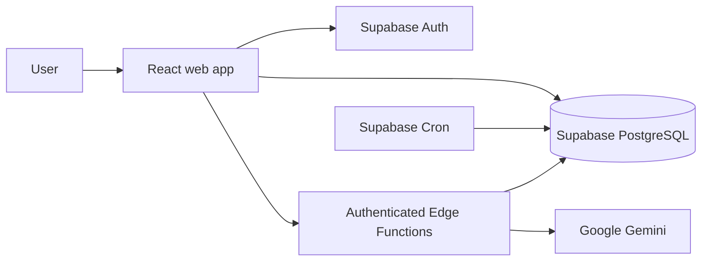

# TinyShift

TinyShift helps people build habits that fit changing levels of time and energy.
Each habit connects to a familiar moment and has two versions: a usual step and
a smaller step for difficult days.

## What it does

- **Today:** plan around available time and energy, complete habits, and undo today's check-ins.
- **Rescue:** take a smaller step or record why a habit was skipped.
- **Adjust:** review patterns from the previous week and accept or reject suggested changes.
- **Reflect:** view weekly activity and save a personal reflection.
- **Profile:** edit your display name and photo, configure reminders, export your information,
  reset your password, or delete your account with confirmation.
- **Habit management:** create, edit and remove habits with Daily or Weekdays schedules.
- **Optional AI:** turn a goal into an editable habit draft, request a weekly review,
  or get a suggested habit adjustment. Suggestions do not change habits without approval.

Daily planning and activity-based suggestions use rules, not AI. Missing check-ins
are not treated as skipped days. AI adjustments need enough recorded activity to
produce a suggestion and can recommend leaving a habit unchanged.

Reminders appear inside TinyShift. Opt-in scheduled processing can prepare weekly
suggestions while the app is closed; it does not send push notifications or reminder
emails, and does not generate AI suggestions in the background.

## Architecture

The frontend uses React, TypeScript, Vite and Tailwind CSS. Supabase provides
authentication, PostgreSQL with per-account access policies, and Edge Functions.
Google Gemini is called only by server-side AI functions.



### Repository layout

- `src/`: screens, shared UI, adaptive planning logic and service clients.
- `backend/sql/`: ordered database setup scripts and optional scheduler setup.
- `backend/supabase/functions/`: AI and account-deletion endpoints.
- `public/`: static assets.
- `scripts/` and `tests/`: automated checks and test fixtures.
- `MANUAL_TESTING.md`: manual feature and release checks.

## Local setup

### 1. Install dependencies

Use Node.js 22 and npm. From the repository root:

```sh
npm ci
cp backend/.env.example backend/.env
```

Set these values in `backend/.env` using your Supabase project's API settings:

```dotenv
EXPO_PUBLIC_SUPABASE_URL=https://your-project.supabase.co
EXPO_PUBLIC_SUPABASE_ANON_KEY=your-public-anon-or-publishable-key
```

Vite reads this file from `backend/`. The two values are deliberately exposed to
the browser; database access is protected by Supabase authentication and row-level
security. Never use a service-role or secret key as the public key.

### 2. Set up Supabase

For a new project, run `backend/sql/001_profiles.sql` through
`backend/sql/010_account_privacy.sql`, in filename order, in the Supabase SQL Editor.
These are manually applied scripts, not CLI-managed migrations. Do not rerun an
existing database's setup just to deploy frontend changes.

Enable email/password authentication. Set the Auth Site URL and allow the local
password-recovery redirect `http://localhost:3000/?account=recovery`.
Configure email verification and delivery for your environment.

For scheduled reminders and weekly preparation, enable Supabase Cron, then run
`backend/sql/enable_routine_cron.sql` separately. The job runs every five minutes.
Do not run `manual_test_history.sql` against real user data.

### 3. Deploy the backend functions

Install or invoke the [Supabase CLI](https://supabase.com/docs/guides/functions/deploy).
From `backend/`, replace `YOUR_PROJECT_REF` with your project's reference:

```sh
cd backend
npx supabase login
npx supabase functions deploy create-habit-draft --project-ref YOUR_PROJECT_REF --no-verify-jwt --use-api
npx supabase functions deploy create-weekly-review --project-ref YOUR_PROJECT_REF --no-verify-jwt --use-api
npx supabase functions deploy create-habit-adjustment --project-ref YOUR_PROJECT_REF --no-verify-jwt --use-api
npx supabase functions deploy delete-account --project-ref YOUR_PROJECT_REF --no-verify-jwt --use-api
cd ..
```

These endpoints validate the signed-in user's token inside each function.
`--no-verify-jwt` disables the gateway check, not the endpoint's authentication.
`--use-api` uses remote bundling without a local Docker installation.

Set `GEMINI_API_KEY` and `GEMINI_MODEL` in the project's
[Edge Function secrets](https://supabase.com/docs/guides/functions/secrets).
Choose a model available to your Gemini account. Supabase supplies its own runtime
credentials; account deletion uses the server-only service-role credential.
Never put these private credentials in frontend configuration.

The older `generate-routine-suggestions` function is not used by the current UI.
Do not deploy it as part of this setup; review any existing deployment separately.
Without Gemini configuration, manual habit creation and rule-based planning still work.

### 4. Start the app

```sh
npm run dev
```

Open `http://localhost:3000`. Restart the server after changing environment values.

## Deployment

For Vercel, import the repository using the **Vite** preset:

- Root directory: repository root.
- Build command: `npm run build`.
- Output directory: `dist`.
- Environment variables: the same two `EXPO_PUBLIC_SUPABASE_*` values above.

Set Supabase's Auth Site URL to your production domain and allow its exact recovery
URL, such as `https://your-app.vercel.app/?account=recovery`.
Check verification and password-reset emails on the deployed domain.
Frontend hosting does not deploy SQL scripts, Cron jobs or Edge Functions.
Redeploy a function only when its code or shared dependencies change.

## Checks

```sh
npm run lint
npm run build
node scripts/check-repository.mjs
```

GitHub Actions runs type checks, a production build, service tests, an isolated
database suite and mocked browser checks. See [MANUAL_TESTING.md](MANUAL_TESTING.md)
for live-account verification. Automated tests do not establish that hosted
settings, email delivery or AI responses are correct.

## Security and current scope

- Local environment files, dependencies, build output and tool caches are ignored.
  Only placeholder environment templates belong in Git.
- AI inputs are sent only after the user agrees to the data described in the UI.
  Gemini requests are limited per account and handled server-side.
- Habit removal keeps historical records. Account deletion is a separate permanent
  operation with password re-verification and typed confirmation.
- This is an application under active development, not a production-certified release.
  Before public launch, verify access policies, email delivery, privacy disclosures,
  backups, monitoring, provider budgets and realistic usage limits.
- Push notifications, reminder emails, email-address changes and an MFA management
  interface are not implemented. Re-verified deletion does not support accounts
  with verified MFA factors.

Do not commit real keys, account exports or database dumps. If a secret was ever
committed, rotate it; adding it to `.gitignore` does not remove it from Git history.
